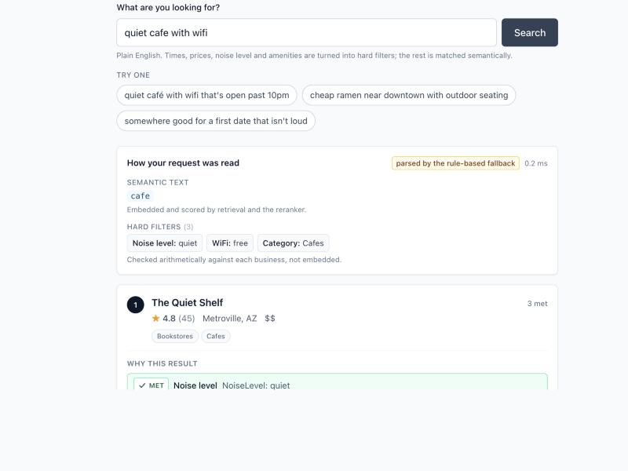
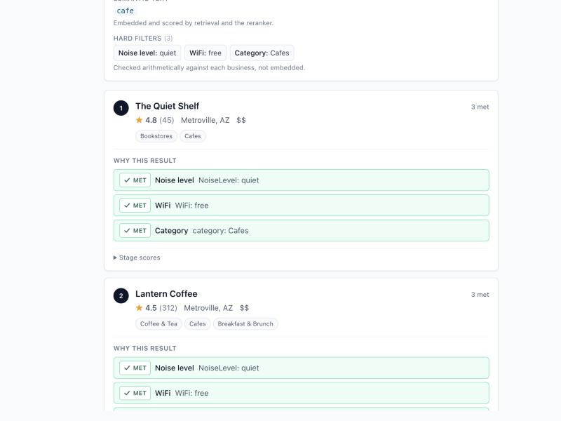

# Concierge — natural-language place search

Concierge answers requests for a place the way you would ask a hotel concierge, not the way
you would phrase a keyword query. You type **"quiet café with wifi that's open past 10pm"**,
**"cheap ramen near downtown with outdoor seating"**, or **"somewhere good for a first date
that isn't loud"**, and it returns ten ranked places together with the part of the request
each one actually satisfies — and, just as importantly, the part it *cannot verify*, because
the underlying data is often silent. It is a four-stage retrieval-and-ranking cascade built
on the [Yelp Open Dataset](https://www.yelp.com/dataset): an LLM turns the request into
semantic text plus hard filters, hybrid lexical + dense retrieval produces a candidate set, a
fine-tuned cross-encoder reranks the shortlist, and a LambdaMART model makes the final
ordering by blending relevance with quality and constraint signals.

Two of the four stages are models trained here (the cross-encoder and the LambdaMART ranker).
The evaluation — a hand-labeled gold set with pooled graded judgements, bootstrap confidence
intervals, paired comparisons, and label-quality checks — is the part of this project I would
most want to be asked about.

> ### Status: the system is built; the numbers are not in yet
>
> **This README contains no results, and no estimated, simulated or illustrative stand-ins
> for results.** Every metric in it appears only after the gold set has been labeled by hand,
> and arrives by running `make eval`, which writes a markdown report, a machine-readable
> `results.json` and a latency figure. Sections below that will hold numbers are marked
> **PLACEHOLDER** and state the exact command that fills them. A number invented to make a
> table look finished would make every other number here worthless, so there are none.
>
> Concretely: no dataset is downloaded in this checkout, `artifacts/` is empty, neither model
> has been trained here, and `eval/gold_queries.csv` holds only format examples. What exists
> is the code, the tests, and the harness that produces the numbers. [Open
> defects](#known-defects-open) are listed as defects, not omitted.

---

## See it running

No dataset required. `make demo` serves the **real** API and the **real** pipeline over the
eight business records in `tests/fixtures/` — same parsers, same document builder, same BM25
index, same constraint evaluation. Only the corpus is small.

```bash
make demo                                             # terminal 1 — API on :8000
cd web && CONCIERGE_API_URL=http://127.0.0.1:8000 npm run dev   # terminal 2 — UI on :3000
```

**Stage 1 is made visible.** The request is split into the text that gets embedded and the
filters that get checked arithmetically, so you can see what the system understood before you
look at what it returned:



**Every result shows which parts of the request it satisfies** — and the UI distinguishes
*satisfied*, *violated*, and *no data*, because the dataset is frequently silent and showing
"no data" as a failure would misrepresent both the business and the system:



> These screenshots are from the fixture corpus, so they demonstrate **function, not quality**.
> The amber banner above the results (cropped out here only for legibility) lists exactly which
> stages are missing — with no FAISS index and no trained models, the service states on every
> response that these are *not* hybrid-retrieval, *not* fine-tuned-reranker and *not*
> final-ranker results. A screenshot from this demo cannot be mistaken for a measurement.

---

## Architecture

Read the right-hand column first: it is the whole argument for the shape. The methods that look
at every business are the ones whose per-business cost is a few arithmetic operations, and the
one stage that pays a transformer forward pass per candidate only ever sees a shortlist the
cheap stages have already narrowed. How much that actually costs in milliseconds is what the
latency table measures; the structure is what makes it affordable at all.

```
   "quiet café with wifi that's open past 10pm"
                      │
 ┌────────────────────┴─────────────────────────────────────────┬──────────────────┐
 │ STAGE 1 · Query understanding       concierge/query/         │  1 request       │
 │                                                              │                  │
 │   cache ──► LLM (Gemini Flash) ──► rule fallback             │  one LLM call,   │
 │   never raises; records which path answered                  │  cached by       │
 │                                                              │  prompt + query  │
 │   semantic_text  "quiet cafe with wifi"   → models           │                  │
 │   hard filters   NoiseLevel=quiet, WiFi=free                 │                  │
 │                  open_at=(day, 22:00)     → arithmetic       │                  │
 └────────────────────┬─────────────────────────────────────────┴──────────────────┘
                      │                  ▼ every open business in the metro
 ┌────────────────────┴─────────────────────────────────────────┬──────────────────┐
 │ STAGE 2 · Hybrid retrieval      concierge/retrieval/         │  the whole metro │
 │                                                              │                  │
 │   BM25           exact terms, rare words   ─┐                │  sparse slices + │
 │   dense + FAISS  meaning, paraphrase       ─┤                │  one embedding + │
 │                                             ▼                │  one inner-      │
 │   Reciprocal Rank Fusion   ranks only, no rescaling          │  product scan    │
 │   hard filters             SATISFIED/VIOLATED/UNKNOWN        │                  │
 └────────────────────┬─────────────────────────────────────────┴──────────────────┘
                      │  candidates.retrieve  ▼ ~200
 ┌────────────────────┴─────────────────────────────────────────┬──────────────────┐
 │ STAGE 3 · Cross-encoder reranker   concierge/rerank/         │  ~200 candidates │
 │           ── fine-tuned here ──                              │                  │
 │                                                              │  ONE TRANSFORMER │
 │   reads (query, document) jointly in one forward             │  PASS EACH — the │
 │   pass, so nothing can be precomputed or cached              │  expensive stage │
 └────────────────────┬─────────────────────────────────────────┴──────────────────┘
                      │  candidates.rerank    ▼ ~50
 ┌────────────────────┴─────────────────────────────────────────┬──────────────────┐
 │ STAGE 4 · LambdaMART final ranker     concierge/ltr/         │  ~50 candidates  │
 │           ── trained here ──                                 │                  │
 │                                                              │  one boosted-    │
 │   11 features: every upstream score and rank, stars,         │  tree prediction │
 │   log1p(review_count), constraint counts, the                │  each            │
 │   "no data" indicator, category match, distance              │                  │
 └────────────────────┬─────────────────────────────────────────┴──────────────────┘
                      │  candidates.final     ▼ 10
         10 results, each with "why this result":
         met · not met · no data   —  never collapsed to a boolean
```

**Why it is shaped like this.** Accuracy and cost move together, so the cascade spends its
compute where it buys the most ranking quality. The cheap methods run over everything: a BM25
query is a few sparse-column slices, and a dense query is one embedding plus an inner-product
scan over precomputed document vectors — both are affordable across the whole metro. The
cross-encoder is the opposite: it concatenates the query with a document and runs the
transformer over the pair, so nothing can be precomputed and the cost is one forward pass per
*(query, document)* pair. Scoring every business that way per query is out of the question;
scoring a shortlist is routine. Stage 4 is cheap again — a few hundred boosted trees over a
small feature matrix — but it can only be cheap *because* it sits at the end, where it has
upstream scores to consume as features.

**Each boundary trades recall for precision.** Stage 2 maximizes the chance the right place is
*somewhere* in the candidate set; Stages 3 and 4 spend progressively more compute per candidate
to get it to rank 1. A place Stage 2 misses can never be recovered, which is why the retrieval
stages are measured with Recall@100 and the ranking stages with NDCG@10 — different stages fail
in different ways and need different metrics to catch it.

**The depths are settings, not constants.** `candidates.retrieve` / `candidates.rerank` /
`candidates.final` live in `configs/base.yaml` (shipped at 200 / 50 / 10) and are swept in the
quality-vs-latency curve — the measurement that says whether 200 was the right place to draw
the line. Picking them honestly is subtler than it looks, and `eval/README.md` explains why the
sweep that *chooses* them must run on a different query set from the one that *reports* them.

---

## The four stages

### Stage 1 — Query understanding (`concierge/query/`)

Splits the request into **soft text** the models embed and score, and **hard filters** checked
arithmetically. The split is the whole point of the stage: an embedding will happily return a
café that closes at 6pm for "open past 10pm", because the prose about late-night studying
matches. Hours and price are facts, so they are checked as facts.

- **Three paths, in a fixed order: cache → LLM → rules.** The LLM is Gemini Flash (free
  tier), with Groq as a second provider, asked for strict JSON validated against a closed
  schema (`schema.py`): an unknown attribute key or an out-of-vocabulary value such as
  `NoiseLevel="pretty quiet"` is rejected rather than passed through, because a value that
  matches no business looks exactly like a ranking failure.
- **A parse failure never reaches the user.** A rate-limited API falls back to a regex parser
  (`rules.py`) that handles the genuinely regular constraints — hours, wifi, outdoor seating,
  noise, price, obvious category words. Which path answered is recorded on every
  `ParsedQuery` (`ParseSource.LLM / CACHE / RULES`), so the ablation can report LLM parsing
  as its own row and attribute both its quality *and* its latency honestly.
- **The cache is keyed by the prompt, not just the query.** `(provider, model, prompt_version,
  normalized query)`, where `prompt_version` includes a hash of the prompt body and the
  attribute vocabulary. Editing the prompt is editing the parser, so it must invalidate the
  cache; changing an unrelated config knob must not.
- **Key design decision:** the rule parser is not just a safety net, it is the baseline the
  LLM has to beat. "We used an LLM" is a claim; the gap between the `llm_parse` row and the
  rules row is a measurement.

### Stage 2 — Hybrid retrieval (`concierge/retrieval/`)

- **BM25** (`bm25s`) over one text document per business, and a **dense bi-encoder**
  (`BAAI/bge-small-en-v1.5`) behind a FAISS index. They fail in opposite directions: the
  embedding knows "ramen" and "noodle soup" are related but is weak on rare literal tokens
  ("birria", a neighbourhood name); BM25 is the reverse. Fusing them is cheaper than fixing
  either.
- **Reciprocal Rank Fusion**, `score = Σ 1/(k + rank)`, with `k` a setting (60 in the shipped
  config). BM25 scores are unbounded and corpus-dependent; cosine similarities sit in [-1, 1]
  and bunch near the top. Adding them requires a normalization choice that is itself an untuned
  hyperparameter, and min-max normalizing per query makes a document's score depend on which
  other documents happened to be retrieved. RRF uses only ranks, so it is invariant to both
  scales. `weighted_sum_scores` is implemented alongside it so the alternative can be measured
  rather than dismissed.
- **Exact FAISS first** (`IndexFlatIP` over L2-normalized vectors, so inner product *is*
  cosine). Starting approximate would bake an unmeasured approximation error into every quality
  number downstream. HNSW is a later move, to be made only with the recall cost measured. The
  index is stored with a `DenseIndexMeta` record beside it — model name, dimension, query
  prefix, normalization flag — because many small embedding models are 384-dimensional, so an
  index built by a different model loads without error and returns confident garbage.
- **Hard constraints are three-valued, not boolean** (`filters.py`). `SATISFIED` /
  `VIOLATED` / `UNKNOWN`, because attribute coverage in this dataset is sparse: "this café has
  no `NoiseLevel` field" is a different statement from "this café is loud". Treating missing
  data as a failure throws away large numbers of good results; treating it as a pass fills the
  list with places that may well violate the request. Neither is defensible, so the policy is
  a config knob (`exclude` / `penalize` / `neutral`) whose effect gets measured, and `UNKNOWN`
  is surfaced in the UI as "no data" rather than quietly rounded either way. One scope caveat,
  because it decides which ablation rows that comparison can be read off: `penalize` discounts
  the fused Stage-2 score only, so on a reranked row it differs from `neutral` only through the
  `rrf_rank` feature and tie-breaks. The three-way comparison is interpretable on the
  retrieval-only rows; the Stage-4 version of the question is an ablation of the
  `has_unknown_constraint_data` feature (DECISIONS.md D007).

### Stage 3 — Cross-encoder reranker, fine-tuned here (`concierge/rerank/`)

Initialized from `cross-encoder/ms-marco-MiniLM-L-6-v2` and fine-tuned on synthetic queries
(below) with pointwise binary cross-entropy — the same objective the checkpoint was pretrained
with on MS MARCO, so fine-tuning continues its objective instead of bolting a new head onto
pretrained weights.

- **Written as an explicit PyTorch loop** over `transformers`, not `CrossEncoder.fit()`.
  Forty more lines, and every one of them — labels, forward, loss, backward, clip, step,
  schedule, validate — is visible and defensible. It also removes a train/serve seam: training
  and serving use the same `AutoModelForSequenceClassification` class, so the checkpoint is
  loaded by the code path that saved it.
- **Key design decision:** the training signal is hard negatives mined from the *top of the
  hybrid retrieval list* for each synthetic query. A random business — a tyre shop for "quiet
  spot to read" — is separable on vocabulary alone, so the gradient is near zero and the step
  teaches nothing. At serving time the reranker only ever sees documents that already look
  right; that is the distribution it has to be trained on.
- The cost of that choice is admitted and then handled: some mined negatives are genuinely
  relevant (other quiet cafés with wifi do exist), so an LLM judge grades the hardest ones and
  likely false negatives are removed before training. How many were removed is a reported
  number, not a footnote.
- `model.py` also measures how much of each document actually fits inside `max_length` (a
  setting, 512 tokens in the shipped config). Document text past the window is simply not read
  by the cross-encoder — the last stage that reads document text at all — which puts a ceiling
  on quality *upstream of every model choice*. That is why the document builder puts name,
  categories and attributes at the head and user prose at the tail: truncation takes the tail,
  so the ordering decides what survives.

### Stage 4 — LambdaMART final ranker, trained here (`concierge/ltr/`)

LightGBM with `objective="lambdarank"`, queries as groups. Stages 2 and 3 answer "does this
text match the request"; they say nothing about whether the place is any good, open, or
nearby. Stage 4 learns that blend from labels instead of a hand-written formula with hand-set
weights. Gradients are formed over pairs within a query and scaled by how much swapping the
pair would change NDCG, so the model spends capacity at the top of the list, where the metric
is sensitive.

The eleven features are the four stage scores and ranks (`bm25_score`, `dense_score`,
`rrf_rank`, `cross_encoder_score`), two quality signals (`stars`, `log1p_review_count`), four
constraint signals (`n_constraints_satisfied`, `frac_constraints_satisfied`,
`has_unknown_constraint_data`, `category_match`) and `distance_km`. Note what is *not* there: a
violated-constraint count, because by the time Stage 4 runs the filter stage has normally
dropped the candidates that violate something. `has_unknown_constraint_data` is the interesting
one — it is what lets the model learn from labels how much to discount "we have no data"
relative to "we checked and it passes", a discount Stage 2 currently makes with a hand-set
penalty.

- **Key design decision — the out-of-fold cross-encoder feature.** The cross-encoder's score
  should be one of the strongest features available — `make train-ltr` reports feature
  importance, which is where that stops being a hypothesis and becomes a measurement — and if
  LambdaMART trains on queries the cross-encoder was fine-tuned on, that feature is inflated
  exactly where the labels are. LambdaMART would learn "trust the cross-encoder completely",
  and on unseen queries that lesson is wrong — a model that looks excellent in training and
  mediocre on the gold set, with no single line of code to blame. Synthetic queries are
  therefore split into disjoint cross-encoder and LambdaMART folds, the manifest is checksummed
  to disk, and `assert_out_of_fold` / `verify_splits` make the trainers *fail* rather than warn
  (`ltr.enforce_oof_crossencoder_feature`). This is the subtlest correctness property in the
  system; it is explained in full in [docs/architecture.md](docs/architecture.md).
- **One feature function, used by both training and serving.** `build_feature_row` is a pure
  function of `(ParsedQuery, Candidate, Business)` and there is no second implementation, so
  training/serving feature skew — the failure where offline metrics stay fine while served
  quality quietly drops — has nowhere to live. Missing values are `NaN`, which LightGBM routes
  natively per split, rather than a sentinel `0` or `-1` that the trees would read as a real
  magnitude.
- Feature importance and an ablation that drops the non-text features (`--ablate-non-text`,
  written to a separate `-textonly` artifact directory so the two runs cannot overwrite each
  other) are part of the deliverable, so "ratings and popularity matter" becomes a measurement
  instead of an assumption.

### Serving (`serve/`, `web/`)

The HTTP wire contract is defined in `serve/schemas.py`, deliberately separate from
`concierge/types.py`: the internal types are shaped for making the ablation traceable (frozen
dataclasses, a per-stage `scores` dict, three-valued constraint status), and a browser needs
none of that. The dependency runs one way — the API layer imports the pipeline, never the
reverse.

- `POST /search` returns the ranked results, the parsed query, per-stage timings, per-stage
  candidate counts, and the three constraint buckets (met / not met / no data) that drive "why
  this result". An empty result set is a 200 with zero results, not a 404: "nothing is open at
  3am with outdoor seating" is a correct answer.
- `GET /health` reports which artifacts actually loaded, plus the config fingerprint and the
  variant name. It returns 503 only when the service cannot answer at all — a service running a
  BM25-only configuration is degraded, not broken, and a container probe must not restart it.
  Being able to see *from the response* which stages are live is what keeps a demo honest.
- `serve/load_test.py` drives the API at several concurrency levels and records both
  client-observed and server-reported latency, because they answer different questions: what a
  user waits versus what the cascade costs. `serve/Dockerfile` mounts the indexes and models
  rather than baking them in — partly because the processed files are derived from the Yelp
  dataset and could not be shared in an image, partly so the image is independent of which
  config fingerprint you are serving.
- `web/` is a Next.js page whose job is to make Stage 1 and the three-valued constraints
  visible: the parsed query is shown back to the user split into semantic text and hard
  filters, and every result lists its checks with an icon and a word, never colour alone. "No
  data" is styled neutrally, because rendering a missing `NoiseLevel` as a failure would claim
  a quiet café is loud.

All of that is code and tests. What does not exist yet is the *measurement* — no load test has
been run here, and `serving.use_onnx` stays `false` until a run of
`python -m concierge.rerank.onnx_export` on the serving host says ONNX is actually faster
there. It is not always, and that script prints what it measured rather than assuming.

---

## Quickstart

### 1. Get the data yourself

**No dataset files are committed to this repository, and none ever will be.** The Yelp Open
Dataset is licensed for **educational and non-commercial use**, so you have to download it
yourself and accept its terms:

1. Go to **<https://www.yelp.com/dataset>** and download the dataset archive.
2. Extract `business.json`, `review.json`, `tip.json` into `data/raw/`.
3. `data/` is gitignored (`.gitignore` keeps only `data/.gitkeep`). Please keep it that way —
   and read the Yelp Dataset Terms of Use before publishing a demo that displays any of it.

`review.json` is the large file. Every read in `concierge/data/load.py` goes through DuckDB
with explicit column projection and a semi-join against the in-scope business ids, so the
pipeline never materializes it.

### 2. Set up

```bash
make setup                 # uv sync --all-groups, then consolidate OpenMP (below)
cp .env.example .env       # then paste a free Gemini key from aistudio.google.com/apikey
make test                  # unit tests; nothing here needs the dataset or an API key
```

`pyproject.toml` pins Python to `>=3.11,<3.13`; `uv` fetches a matching interpreter itself, so
no system Python is involved. Tests that need the real dataset are marked `needs_data` and
tests that need a live API are marked `needs_api`; both skip cleanly, so a fresh clone with no
data and no keys still has a green suite.

### 3. Build, index, train

```bash
make explore               # dataset report: per-metro counts, attribute missingness
                           #   → then set data.metro in configs/base.yaml
make data                  # raw JSON → businesses.parquet + documents.parquet
make index                 # BM25 + FAISS indexes over the business documents
make synth                 # synthetic training data: generate → negatives → judge → splits
make train                 # train-reranker (cross-encoder) then train-ltr (LambdaMART)
```

`make synth` chains four stages, each reading only the previous one's artifact out of
`artifacts/synth/<config fingerprint>/`. Run them individually (`make synth-generate`,
`synth-negatives`, `synth-judge`, `synth-splits`) when you want to stop and look. The two that
spend API quota print the exact number of calls and ask first, and all four resume: generation
replays cached responses, mining reuses examples already on disk, the judge caches a verdict
per pair, and splitting is deterministic. Two prerequisites are not obvious from the target
names: hard-negative mining runs the real hybrid retriever, so `make index` has to have
succeeded first; and `synth-generate` deduplicates its output against `eval/gold_queries.csv`
and **refuses to run if that file is missing**, so the gold set has to be written before any
training data is generated. That ordering is deliberate — a missing gold file must not be the
thing that silently switches the leakage guard off.

### 4. Label, evaluate, serve

```bash
make label                 # grade pooled results by hand — see eval/README.md
make synth-label-quality   # judge-vs-owner agreement (Cohen's kappa); needs eval/qrels.csv

# choose the candidate depths on synthetic data, never on the gold set:
uv run python -m eval.run_eval --config configs/base.yaml --sweep-on validation

make eval                  # ablation table, per-type breakdown, latency curve, failures
make serve                 # FastAPI service on :8000
```

One rough edge in that loop is worth knowing before you hit it: `make label` pools from a runs
file (`artifacts/eval/runs.json`) listing each system's ranked ids per gold query, and nothing
in the repository writes that file yet — `make eval` cannot, because it refuses to run before
labels exist. So the first pool comes from running a system over the gold queries yourself and
dumping the result in that shape. `eval/README.md` gives the shape and explains why keeping
that step outside the labeling tool is deliberate.

With the API running, the demo frontend is `cd web && npm install && npm run dev`
(<http://localhost:3000>; it reads `CONCIERGE_API_URL`, defaulting to `http://localhost:8000`).
Its dependencies have not been installed in this checkout, so treat that as untried rather than
verified — `web/README.md` says the same.
To load-test the service: `uv run python -m serve.load_test --url http://127.0.0.1:8000
--queries eval/gold_queries.csv` (`--queries` is required — the tool refuses to invent a query
mix, and it sweeps `--concurrency` levels `1,4,8,16` by default). To containerize it:
`docker build -f serve/Dockerfile -t concierge-search:dev .` from the repo root.

`make help` lists every target; `make lint`, `make fmt` and `make typecheck` are the quality
gates. `configs/base.yaml` holds every tunable, and `data.metro` deliberately ships as `null`:
`make data` refuses to run until you have looked at `make explore` and chosen a scope, so the
project can never silently index the wrong city.

**Order matters, and the tools say so.** Each command fails with an actionable message naming
what is missing rather than defaulting to something plausible. The one exception is the
pipeline itself, which degrades on purpose: with no fine-tuned checkpoint it uses the
pretrained cross-encoder, with no LambdaMART model it ranks by cross-encoder score, and it
*warns* about every degradation — because the pipeline has to be runnable at every point in
the project's own construction.

**One environment hazard worth knowing.** On macOS, `faiss-cpu`, `torch` and `scikit-learn`
each vendor their own copy of LLVM's OpenMP runtime, and `lightgbm` links Homebrew's. Loading
more than one into a single process either aborts the interpreter at the C level with no Python
traceback or — far worse — keeps running and returns wrong numbers, which is LLVM's own
documented failure mode. `make setup` runs `make fix-openmp` to consolidate them; `make
check-openmp` asserts afterwards that one runtime is loaded *and* that FAISS still agrees with
brute-force numpy, because absence of a crash is not evidence of correctness here. The
documented `KMP_DUPLICATE_LIB_OK=TRUE` workaround is deliberately not used: an environment
variable whose stated failure mode is "silently produce incorrect results" is not a foundation
for a benchmark. `make index` also checks for duplicate copies and prints the diagnosis before
starting a long build (`duplicate_libomp_paths` in `concierge/retrieval/build_index.py`), so if
something dies with a segfault or `OMP: Error #15` instead of a Python error, start there.

---

## Results

> ## PLACEHOLDER — no numbers exist yet
>
> Everything in this section is produced by **`make eval`**, which refuses to write a report
> until enough of the gold set is labeled (`eval/run_eval.py` raises `LabelsNotReady` below
> `MIN_LABELED_QUERIES` queries with at least one *relevant* label). Labeling is hand work and
> it is mine to do: `eval/gold_queries.csv` still contains only the shipped `EXAMPLE` format
> rows, which the labeling pool skips so they can never be graded — and which therefore have to
> be deleted before any reported run, since the eval harness's own gold reader still counts
> them in its denominators (see [open defects](#known-defects-open)).
>
> Nothing here is estimated, simulated, or shown as an example value. The tables below are
> printed with their real structure and empty cells so the shape of the claim is visible
> before the claim is made.

Outputs land in `artifacts/eval/<config-fingerprint>/`: `report.md`, `results.json` (every
figure machine-readable at full precision, so no number is ever retyped by hand),
`latency_curve.csv` and `latency_curve.png`.

### Ablation ladder — `make eval`

One row per cascade configuration, defined once as data in `concierge/pipeline.py`
(`ABLATION`) so the table cannot drift from the code that produced it. Each metric arrives
with a bootstrap 95% CI, the number of queries it is defined on, and a paired-bootstrap
comparison against the row above it.

| # | System | NDCG@10 | Recall@100 | MRR | p95 latency |
|---|---|---|---|---|---|
| 1 | BM25 only | — not yet measured | — | — | — |
| 2 | + dense retrieval (RRF fusion) | — not yet measured | — | — | — |
| 3 | + cross-encoder (pretrained) | — not yet measured | — | — | — |
| 4 | + cross-encoder (fine-tuned here) | — not yet measured | — | — | — |
| 5 | + LLM query parsing | — not yet measured | — | — | — |
| 6 | + LambdaMART (full system) | — not yet measured | — | — | — |

Each row adds exactly one thing to the row above it, which is what lets the difference between
two adjacent rows be attributed to that one thing. One property of the ladder is easy to
misread: **hard filtering is on in every row.** Row 5 therefore measures the LLM parser against
the *rule* parser, not against having no constraint handling — rows 1–4 still apply whatever
constraints the rule parser found. Filters-versus-no-filters is a separate diagnostic the same
harness runs, alongside dense-only retrieval, rather than a rung of this ladder, because a row
that changed two things at once could not attribute either.

An em dash in any generated table means "not measured, for this stated reason" —
`eval/report.py` has no code path that renders a missing measurement as `0`.

### Per-query-type breakdown — `make eval`

The same metrics restricted to each of `vibe` / `constraint` / `specific` / `messy`. **Not yet
measured.** This breakdown is a headline result rather than a diagnostic: the stages should
help these four very differently — hard filters ought to earn their keep on `constraint`
queries and do nothing for `vibe`, and the fine-tuned cross-encoder is the stage expected to
matter most on `vibe` and `messy` — and a system that improves overall while getting *worse*
on one type is a finding the aggregate number hides.

### Quality vs. latency — `make eval`

NDCG@10 against p95 latency across `candidates.sweep_retrieve` × `candidates.sweep_rerank`
(the shipped 200/50 depths are one point on this surface). **Not yet measured.** Writes
`latency_curve.csv` and `latency_curve.png`; points with a missing coordinate are dropped
rather than drawn at zero. The gold-set version of this curve is published as a *measurement of
the configured operating point*, and the run prints a warning saying so, because a curve read
off the test set and then used to pick depths is test-set tuning with no code change to blame.
Choosing depths is what `--sweep-on validation` is for.

### Failure analysis — `make eval`

For the worst queries per type, the harness separates the two failure modes that look
identical from the top of the result list: **the good result was never retrieved** (a Stage 2
recall failure, which no amount of reranking can fix) versus **it was retrieved and then
mis-ranked** (a Stage 3/4 failure). **Not yet measured.**

### Label quality — `eval/label_cli.py --agreement`, and `make synth-label-quality`

Three numbers that exist to show the labels can be trusted, none of them measured yet:

- **Test-retest self-agreement.** Exact agreement, Cohen's kappa both unweighted *and*
  quadratic-weighted (the weighted figure is the flattering one on a 3-point ordinal scale, so
  it is never quoted alone), and the confusion matrix, over pairs I graded twice at least two
  weeks apart.
- **LLM-judge vs. my labels.** The same kappa and matrix between the judge and me on a sample
  of pairs I labeled by hand. This is the entire justification for using LLM grades to filter
  training data; if it comes out low, the honest conclusion is to drop that filtering step,
  and that is what will be reported.
- **Leakage and filtering counts.** How many synthetic training queries were removed as
  duplicates of gold queries (exact and by embedding similarity), and how many mined hard
  negatives the judge removed as false negatives.

### Serving latency

p50/p95 per stage and end to end, under load, plus the PyTorch-vs-ONNX parity check and
backend timing from `python -m concierge.rerank.onnx_export`. **Not yet measured.**

---

## Evaluation methodology

This is the part of the project I would defend first, because it is what separates a measured
search system from a demo that looks good on the queries its author happened to try.

**Gold queries.** ~150 queries I write myself, before looking at any results, spread across
four types: `vibe` ("cozy spot to read on a rainy afternoon"), `constraint` ("open after 10pm
with outdoor seating"), `specific` ("good pho"), and `messy` — typos, vagueness, two intents
at once. Writing a query after noticing a nice result is the cheapest way to accidentally fake
a good number, so the order is fixed. No code in this repository writes or edits gold queries;
`eval/README.md` is the full brief, including what makes a query worth testing.

**Pooled graded labels.** 150 queries × a whole metro cannot be judged exhaustively, so the
harness pools: take the top 20 from every system being compared, union them, and grade only
that (TREC's method since 1992). Grades are 0 irrelevant / 1 partially relevant / 2 highly
relevant. Pooling is biased in a known direction — a new system that surfaces good documents
nobody pooled looks worse than it is — so `eval/metrics.py` reports the **unjudged fraction
next to every metric** instead of hiding the assumption. Incremental pooling means a new stage
only costs the newly surfaced pairs, and an already-graded pair is never served again (two
labels for one pair would make every metric depend on which row won).

**A random labeled subset, stated with every number.** Labeling 150 queries at pool depth 20
is many hours of hand work, so a **random, fixed-seed** subset is labeled first
(`evaluation.label_subset_size`, shipped at 50) and expands later. Random is the load-bearing
word: the first 50, the short ones, or the interesting-looking ones each bias the headline
metric in a specific direction. Every reported metric states how many queries it was computed
over — *"NDCG@10 = x over a random 50 of 150 gold queries"* is an honest sentence and the
clause after the comma is not optional.

**Metrics, with their uncertainty.** NDCG@10 primary, Recall@100 for the retrieval stages, MRR.
Every mean carries a bootstrap 95% CI, and consecutive systems are compared with a **paired**
bootstrap over per-query differences, which removes query difficulty from the comparison. With
a set this size, small gaps are noise, and the harness says so in words: a comparison whose
interval crosses zero is reported as not distinguishable, and that sentence is carried verbatim
into the rendered report so it cannot be lost in formatting. A query with no relevant document
has *no* NDCG — not zero — so it is excluded from the mean and counted in the open. Every
metric is unit-tested against tiny hand-made examples whose answers were worked out by hand.

**Self-agreement, because there is one annotator.** "I was careful" is not evidence. The only
second rater available is me, later: `label_cli.py --retest` re-serves pairs I already graded
(for a random subset of queries, without showing the old grade) after a two-week gap, and
`--agreement` prints exact agreement, both kappas, and the confusion matrix. The *shape* of the
disagreement is the interesting part — 1-vs-2 confusion means my middle category is fuzzy,
while 0-vs-2 confusion means the grading rules themselves are broken. Reported numbers are
reported as numbers; kappa interpretation bands are conventions, not thresholds, so no number
here gets translated into a flattering adjective.

**LLM-vs-owner agreement, as a licence to use LLM labels.** The same judge, prompt and rubric
that filter false negatives from the training data are run over a sample of pairs I graded by
hand, and the kappa between us is the justification for using LLM grades at all. The judge is
**read-only with respect to `eval/qrels.csv`** — only my labeling CLI writes labels, because a
judge that could write them would make the evaluation circular.

**Leakage rules, enforced in code and not by discipline.**

- Gold queries and labels are **test-only**: never in training data, prompt examples,
  hyperparameter tuning, or feature engineering. Tuning happens on a synthetic validation
  split, and that includes the candidate depths — `--sweep-on validation` versus the default
  gold run is the mechanism that keeps the operating point out of the test set.
- Synthetic training queries are deduplicated against the gold set **exactly and by embedding
  similarity** (`synth.gold_dedup_cosine_threshold`, shipped at 0.92), the guard **fails loudly
  if the gold file is missing** rather than passing everything through, and the number removed
  is a required reported figure. The threshold is a *high* bar for calling two queries the
  same, so a distant paraphrase of a gold query can survive; nothing here has measured how
  often, and that residual is stated rather than solved.
- Both trainers call `assert_no_gold_leakage` and refuse to run on a match, by query id or by
  normalized text.
- The cross-encoder and LambdaMART folds are disjoint by construction, checksummed, and
  verified at train time (see the out-of-fold discussion above). LambdaMART additionally
  compares the split-manifest checksum its cross-encoder was trained under against the manifest
  in front of it, because two artifacts can each pass their own checks and still disagree.
- Folds are assigned by **hash of a group key**, not by a seeded shuffle, so no query's fold
  depends on how many other queries exist or on their order. The group is a near-duplicate
  *cluster* by default, not a single query, because a paraphrase of a cross-encoder query
  landing in a LambdaMART fold leaks just as surely while every query id looks clean. That
  choice has a cost worth knowing: cluster membership is not monotonic under data growth, so
  the assignment is stable for a fixed query set rather than stable forever, and adding
  synthetic data means re-running the cross-encoder fine-tune. The checksum comparison above is
  what turns that into a refusal to train instead of a quietly broken guarantee.

**Reproducibility.** Fixed seeds; every tunable in `configs/base.yaml`; and every index,
checkpoint, split manifest and eval report written under a directory keyed by a hash of the
whole config, so any figure can be traced back to the exact settings that produced it. Config
parsing forbids unknown keys, because a silently-ignored typo means an experiment that did not
test what it claimed to. A deliberately crippled smoke-test run (`--max-queries`) stamps
`PARTIAL RUN` into the result object and onto every table it renders, so its output cannot be
mistaken for a result.

---

## Limitations

Stated plainly, because each of these bounds what the numbers will be able to claim.

- **One annotator — me.** Every relevance judgement in this project comes from one person, so
  "relevance" here means my judgement applied consistently, not a consensus. The test-retest
  kappa measures the consistency; it cannot measure whether my standard matches anyone else's.
  Those are different questions, and only one of them has an answer here. A second annotator on
  even a slice of the pool is the upgrade that would close the gap, and it is the one thing on
  this list that cannot be bought with more compute.
- **Synthetic training queries.** Both trained models learn from queries an LLM wrote from a
  business document, not from a query log — this is a cold-start search engine with no users.
  LLM-written queries are plausibly cleaner, better spelled, and more single-intent than real
  ones, which likely makes the `messy` query type the weakest part of the system and is a
  specific thing to look for in the per-type breakdown. The gold set is mine, so the
  *measurement* is not synthetic, but the training distribution is.
- **One metro area.** Scope is a single metro chosen on evidence from `make explore`. The
  pipeline is metro-agnostic (changing scope is a config change plus a rebuild), but nothing
  here demonstrates that quality transfers to a city with different category mix, different
  attribute coverage, or different review density.
- **No online evaluation.** There are no users, no clicks, and no A/B test. Every number is
  offline relevance against my labels, which cannot capture whether people would actually be
  satisfied by these results. [The next section](#how-i-would-evaluate-this-online) is how I
  would measure that, framed as design reasoning rather than results, because that is all it
  can be here.
- **Attribute sparsity in the source data.** Many businesses carry no `NoiseLevel`, no `WiFi`,
  and sometimes no hours at all. The system handles this honestly (three-valued constraints,
  "no data" in the UI, a missing-data policy wired as a config knob so it can be measured on
  the retrieval-only rows — D007) but honesty is not coverage: for a constraint the dataset is
  silent about, no ranker can verify the user's request. The `make explore` missingness report
  is the first thing to read before trusting any constraint-query result, and it bounds how
  many gold queries are answerable *in principle*.
- **A snapshot, not a live index.** The dataset is a static export; hours and attributes are
  as of its release, so "open past 10pm" is answered against the data's claim, not reality.
- **No geo resolver, so `distance_km` is inert.** The geo filter and the distance feature both
  exist and are tested, but turning "downtown" into coordinates needs a gazetteer this
  repository does not have, and nothing wires a resolver into the pipeline. So `parsed.geo` is
  always `None` on the live path and `distance_km` is `NaN` for every candidate. It degrades
  deliberately rather than silently — an unresolved location phrase is folded back into
  `semantic_text`, so "pharmacy near the train station" still retrieves on the words — and
  `eval/README.md` says to keep "near X" queries out of the gold set until it works, because
  labeling them now would score missing functionality as a ranking failure (D003).
- **Known-unknowns deliberately left as config knobs.** The missing-attribute penalty, RRF's
  `k`, the document length cap, and the 200/50/10 depths are starting points from the
  literature or from reasoning, not tuned results. `DECISIONS.md` marks each of them
  **Provisional** and names the experiment that would settle it. None of them is presented as
  a finding.

### Known defects (open)

Tracked rather than hidden. Each has a `DECISIONS.md` entry; none of them is presented as
solved, and the project's own rule is that a defect with a plausible-sounding workaround in the
README is worse than a defect in a list.

- **Constraint phrase stripping is not uniform, and the constraint fix is unmeasured against
  labels** (D224, D225). The original defect — a query whose constraint phrases are stripped
  down to a generic residue matches no document, so retrieval returns nothing and the
  *correctly parsed* hard constraints never get applied — is closed:
  `concierge/retrieval/constraints_index.py` generates candidates from the constraints
  themselves and `pipeline._retrieve` backfills with them when retrieval under-delivers. What
  is still open is two things. First, the stripping itself is inconsistent: some constraint
  phrases are removed from `semantic_text` and others are left in, and the rule should be
  uniform and stated because the double-counting argument elsewhere assumes it is. Second,
  the fix is verified by execution on the fixture corpus — the queries in D224's table are
  `D224_TABLE` in `tests/test_constraint_retrieval.py` and are asserted end to end under all
  three missing-data policies — but *not* measured against relevance labels, because none
  exist yet. The per-query-type breakdown for `constraint` queries is the measurement that
  would confirm it helps rather than merely that it returns something, and that measurement
  needs the gold set. Treat it as a defect whose mechanism is fixed and whose benefit is
  unquantified.
- **Stage 4 has no trainable input yet.** `make train-ltr` reads labeled feature rows from
  `artifacts/synth/<fp>/ltr_examples.jsonl`, and no stage in this repository writes that file —
  the flag's own help text says so. Building it needs a pass that runs retrieval and the
  *fine-tuned* cross-encoder over each LambdaMART-fold query, which can only happen between the
  two trainers. It fails closed with the missing path named, which is the right direction: a
  hand-assembled examples file is exactly the stale-feature-distribution hazard the shared
  feature function exists to prevent. That producer is in flight.
- **The eval harness counts `EXAMPLE` gold rows.** The labeling pool skips ids prefixed
  `EXAMPLE`, so the shipped format rows can never be graded — but `eval/run_eval.py`'s own gold
  reader does not skip them, so they land in the query-type counts and in the coverage
  denominator while being permanently unlabelable. Deleting them before labeling begins is
  correct advice and is in `eval/README.md`; the two readers agreeing by construction is the
  actual fix, and it is being wired up.

---

## How I would evaluate this online

The project has no users, so none of this is a result — it is the design I would propose if it
shipped, and it is here because "how would you measure this in production?" is a near-certain
interview question and offline NDCG is not a sufficient answer.

**Interleaving before A/B tests.** For ranking changes, I would start with team-draft
interleaving: for each query, build one list by alternately letting the two rankers draft their
next-best unused result, then attribute each click to the ranker that contributed that
document. Every user sees one blended list, so the comparison is *within* user and within
query, which removes almost all of the variance that makes ranking A/B tests need enormous
traffic. The interleaving literature's central claim is that it detects ranking differences
with far less traffic than an A/B test on a session metric — I have measured nothing of the
kind here, and I would want to verify the sensitivity on our own logs before relying on it,
but it is the reason to reach for interleaving first on a low-traffic product. Its limits are
real too: it measures *preference between two rankers*, not the absolute quality of either, it
cannot evaluate changes to the result card or the number of results shown, and clicks on a
blended list are not evidence about how a user would behave on a page they would actually see —
so I would use it to choose between rankers and an A/B test to decide whether the change is
worth shipping.

**Position bias is the main threat to any click-based conclusion.** Users click the top result
because it is on top, so raw click-through rate ranks the ranker's own past decisions rather
than relevance. Two complementary handles:

- *Randomization to estimate the bias.* Swap adjacent pairs, or shuffle within a small window,
  on a small traffic slice, and compare click rates for the same document at different
  positions. That gives a position propensity curve.
- *Inverse-propensity weighting to correct for it.* Weight each observed click by 1/propensity
  for its position, which makes the resulting estimator of relevance unbiased under the
  examination assumption (a document is clicked only if examined, and examination depends on
  position). The price is variance at low propensities, which means clipping the weights and
  being honest that clipping reintroduces some bias.

The engineering consequence is the part that is easy to forget and impossible to retrofit:
**propensities have to be logged at serve time**, alongside the ranker version, the variant,
and the candidate set each stage produced. Reconstructing "what was the chance this document
was shown here?" after the fact from a ranking you no longer have is guesswork. In this
cascade I would log per-stage candidate ids and scores for a sampled fraction of traffic — the
`SearchResponse` already carries them — because a reranker change that looks like a ranking win
can also be a Stage 2 recall change, and only the stage-level log can tell those apart.

**Click models as noisy relevance signals, never as labels.** A cascade model (the user scans
top-down and stops at a click) or a dynamic Bayesian network (separating attractiveness —
was the snippet appealing — from satisfaction — did they come back) can turn click logs into
per-document relevance estimates good enough to train a ranker on. Three cautions I would hold
onto: these estimates are *downward biased for anything the current system ranks low*, because
documents that are never shown are never examined and therefore never clicked, so training on
them alone makes the system progressively more confident in its own earlier choices — the
feedback loop that makes a deployed ranker's logs a worse training set every month unless some
exploration traffic is deliberately preserved; a click is attraction, not satisfaction, so a
dwell-time or return-click threshold is a better target than a raw click; and nothing stops a
click model from encoding the biases of whoever wrote the snippet. I would keep a small
human-labeled set — the same kind of gold set as here — as the calibration anchor that
click-derived labels get checked against, and I would re-label it periodically rather than
treating it as a fixed asset, because the query distribution moves.

**Metrics I would commit to in advance.** A primary that reflects the product (successful
sessions: a click with sufficient dwell, or a tap through to directions or a phone number),
plus guardrails that catch the failure modes a ranking change causes: query reformulation rate,
abandonment, zero-result rate, and p95 latency — because this cascade can buy quality with
latency, and a quality win that costs a visible fraction of a second may be a product loss.
Constraint queries would get a dedicated guardrail on "hard constraint violated in the top 3",
since that is the error users punish hardest and an aggregate relevance metric barely notices
it. The offline analogue of that guardrail already exists here in the three-valued constraint
status, which is the main reason I would expect the offline and online stories to line up at
all.

**What would make me distrust a win.** A result that appears only in the aggregate and not in
any query segment; a win that coincides with a latency regression; a win driven by a handful
of head queries; a win on clicks with no movement in dwell or return visits; and anything that
moves before the fixed horizon of a sequentially-monitored test, where repeated peeking
inflates false positives unless the test was designed for it. The honest version of this
section is that I would expect the first two or three online experiments mostly to teach me
that my logging was inadequate, which is the argument for designing the logging before the
experiment rather than after.

---

## Repository layout

```
concierge/
  types.py          shared contracts every stage speaks (frozen dataclasses)
  config.py         typed pydantic config; artifacts keyed by its hash
  pipeline.py       the four stages wired into one callable, with ablation variants
  data/             loading (DuckDB, streaming), attribute + hours parsing, documents
  query/            Stage 1: LLM client, JSON schema, SQLite parse cache, rule fallback
  retrieval/        Stage 2: BM25, dense + FAISS, RRF fusion, three-valued hard filters
  rerank/           Stage 3: training loop, inference, ONNX export + parity check
  ltr/              Stage 4: pure feature function, LambdaMART training
  synth/            synthetic queries, hard negatives, LLM judge, fold assignment
eval/
  gold_queries.csv  written by hand (owner-only)
  label_cli.py      the pooled labeling tool
  pooling.py        which pairs get asked about; incremental pooling
  metrics.py        NDCG / Recall / MRR, bootstrap CIs, paired bootstrap, kappa
  run_eval.py       the ablation harness behind `make eval`
  report.py         renders report.md, results.json, the latency curve
serve/              FastAPI app, wire schemas, load test, Dockerfile
web/                Next.js demo frontend ("why this result")
configs/base.yaml   every tunable
scripts/            OpenMP consolidation and verification
docs/               architecture.md
tests/              unit tests, including fixtures covering the dataset's quirks
```

Three companion documents:

- **[docs/architecture.md](docs/architecture.md)** — data flow end to end, business document
  design, the artifact/config-hash scheme, where each trained model comes from, a careful
  treatment of the out-of-fold cross-encoder feature, and a table of the silent failures the
  structure exists to prevent.
- **[DECISIONS.md](DECISIONS.md)** — every meaningful choice with the alternatives considered,
  the reason, and how it could be tested. Decisions are marked **Settled**, **Provisional** (a
  default awaiting a measurement) or **Deferred**, so nothing chosen by reasoning alone can
  pass itself off as a result.
- **[eval/README.md](eval/README.md)** — how the gold set is written and labeled, including
  the grading rubric for the hard middle case and why the operating point counts as a tuned
  parameter.

## Data and licensing

Built on the **Yelp Open Dataset**, which is licensed for educational and non-commercial use
and must be obtained directly from <https://www.yelp.com/dataset>. No dataset file is
committed here, in any form, derived or otherwise. This project is not affiliated with,
endorsed by, or branded as Yelp; the dataset is an input, not the product. Anyone deploying a
public demo of this code should read the Yelp Dataset Terms of Use first to confirm what may
be displayed.
